<div align="center">

<picture>
  <source media="(prefers-color-scheme: dark)" srcset=".github/assets/banner-dark.svg">
  
</picture>

**Make application routes visible to the operating system.**<br>
Publish typed PAM routes as Android shortcuts and Apple App Intents while keeping deep-link inputs bounded and validated.

[](https://packagist.org/packages/pushinbr/pam-native-intents)
[](https://github.com/push-in/pam-native-intents/releases/latest)

[](https://github.com/push-in/pam-native-intents/actions/workflows/ci.yml)
[](LICENSE)

[Install](#install) · [Quick example](#quick-example) · [Platforms](#platform-support) · [Requirements](#requirements) · [Reference](docs/reference.md) · [Issues](https://github.com/push-in/pam-native-intents/issues)

</div>

<a id="install"></a>
## <picture></picture> Install

Inside a PAM Native project, add only this capability:

```sh
pam composer require pushinbr/pam-native-intents
pam doctor --fix
```

New to PAM? Create a project with `pam init my-app --template native` (see the [PAM Native overview](https://push-in.github.io/pam-docs/native/overview/)), then come back here.

<a id="quick-example"></a>
## <picture></picture> Quick example

```php
use Pam\Native\Intents\IntentAction;
use Pam\Native\Intents\Intents;

$intents = new Intents();

$intents->register([
    new IntentAction('inbox', 'Open inbox', 'myapp://inbox', 'Unread messages'),
], function (bool $ok, ?string $error): void {
    // published, or $error explains why not
});
```

Actions use deep links so the normal named-route lifecycle remains the single source of navigation truth. `register()` accepts at most 15 actions; `clear()` removes them all. Identifiers are validated (`[A-Za-z0-9][A-Za-z0-9_.-]{0,63}`), titles are at most 80 bytes and subtitles 120.

<a id="platform-support"></a>
## <picture></picture> Platform support

| Platform | Support | Notes |
| --- | --- | --- |
| Android | API 26+ | Dynamic Shortcuts; custom URL schemes supported |
| iOS | 18.0+ | AppIntents, App Shortcuts extension `PamAppIntents` |
| PAM Native | 0.8.0 to < 2.0.0 | From `pam-native.plugin.json`; PHP 8.5+ |

<a id="requirements"></a>
## <picture></picture> Permissions and requirements

No runtime permissions are declared. On iOS the plugin adds an App Intents extension and entitlements (`ios/App.entitlements`, `ios/IntentExtension/PamAppIntents.entitlements`).

- iOS 18+ uses the shared `group.<application-id>.pam-native` container.
- Apple requires the `OpenURLIntent` destination to be an HTTPS universal link associated with the app; custom URL schemes remain supported by Android Dynamic Shortcuts.
- Keep titles stable: users may build automations that outlive an application update.

<a id="what-you-can-build"></a>
## <picture></picture> What you can build

- Siri and system search actions
- Android dynamic shortcuts
- Contextual entry points into specific application routes

| | |
| --- | --- |
| **Native path** | Android Shortcuts · App Intents |
| **Application model** | Composer package + generated native integration |
| **Design rule** | Independent module; no feed, vertical, or application template bundled |

<a id="production-checklist"></a>
## <picture></picture> Production checklist

- Keep action identifiers and titles stable across releases.
- Route all actions through the app's normal named-route lifecycle.
- Use associated HTTPS universal links for Apple OpenURLIntent destinations.
- Run `pam doctor`, `pam test`, and a signed release build on every supported platform.
- Exercise denial, cancellation, backgrounding, process restart, and offline behavior before release.

Platform SDKs, credentials, entitlements, physical hardware, and store configuration remain application responsibilities. Report security vulnerabilities through GitHub private vulnerability reporting, not a public issue.

<a id="docs"></a>
## <picture></picture> Docs

- [Reference](docs/reference.md): install details, API guide, troubleshooting
- [PAM Native overview](https://push-in.github.io/pam-docs/native/overview/)
- [Plugin and native capability model](https://push-in.github.io/pam-docs/native/plugins/)
- [Changelog](CHANGELOG.md)
- [Report an issue](https://github.com/push-in/pam-native-intents/issues)

<a id="pam-ecosystem"></a>
## <picture></picture> Part of the PAM ecosystem

PAM runs PHP natively on servers, desktops and phones. This repository is one piece of it.

| [**PAM**](https://github.com/push-in/pam) | [**PAM Desktop**](https://github.com/push-in/pam-desktop) | [**PAM Native**](https://github.com/push-in/pam-native) | [**Ecosystem**](https://github.com/push-in/pam#ecosystem) |
| --- | --- | --- | --- |
| the runtime and CLI | native desktop apps in PHP | native Android and iOS apps in PHP | every official package and plugin |

<sub>Docs: [push-in.github.io/pam-docs](https://push-in.github.io/pam-docs/introduction/) · [Issues](https://github.com/push-in/pam-native-intents/issues)</sub>

<p align="center"><sub><a href="LICENSE">Apache License 2.0</a> · Made in Brazil by Pushin</sub></p>
